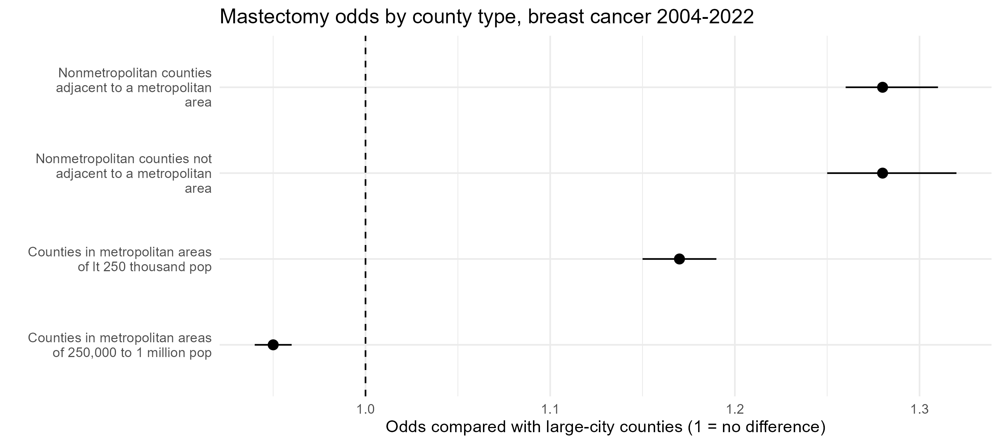

# Breast Cancer Surgery Type by County Type (SEER, 2004-2022)

## Question
Are women with localized breast cancer in rural counties more likely to have a mastectomy instead of breast-conserving surgery than women in large-city counties?

## Data
SEER Research Data (17 registries, 2004-2022). Women with localized-stage breast cancer who had either a mastectomy or breast-conserving surgery (about 700,000 women). The data is not included here because SEER's rules do not allow sharing it.

## Methods
Done in R. I grouped the SEER surgery codes into mastectomy and breast-conserving surgery, then used logistic regression to compare county types, adjusting for age group, race, marital status and diagnosis year.

## Main finding
Women in rural (nonmetropolitan) counties had about 28% higher odds of a mastectomy than women in large-city counties (odds ratio 1.28, 95% CI 1.25 to 1.32), even after adjusting for the factors above. Women in small metro counties had odds about 17% higher (1.17).

## Limits
- This shows an association, not a cause.
- This SEER database has no insurance information and no distance to radiation centers, so I cannot test why the gap exists.
- Only localized-stage cases were included.
- Similar studies on rural-urban surgery differences exist, so this project is a learning and portfolio project, not a new discovery.

## Files
- `seer_breast_analysis.R`: full analysis code
- `county_chart.png`: odds of mastectomy by county type
- `trend_chart.png`: mastectomy rate by year, rural vs other counties
- `race_chart.png`: rural vs other counties by race

## Next steps
"Test why the gap narrowed, and why it differs by race, using data with insurance and distance to radiation facilities."